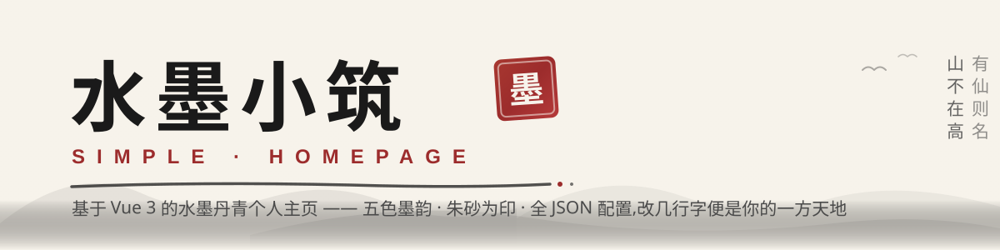
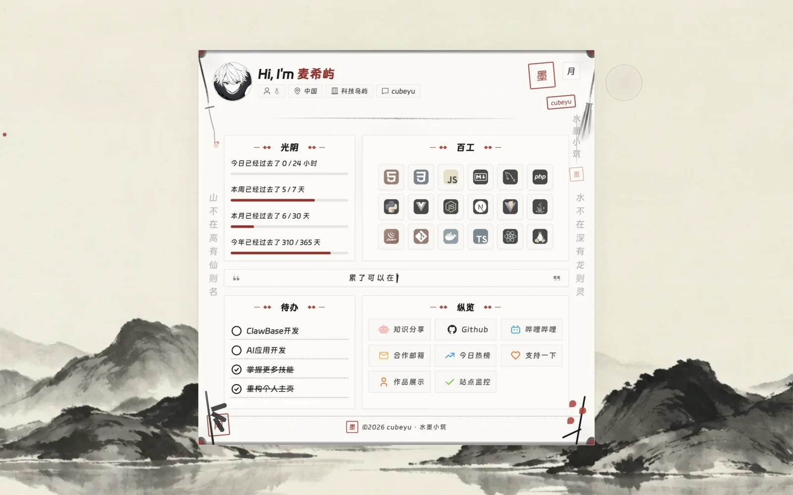
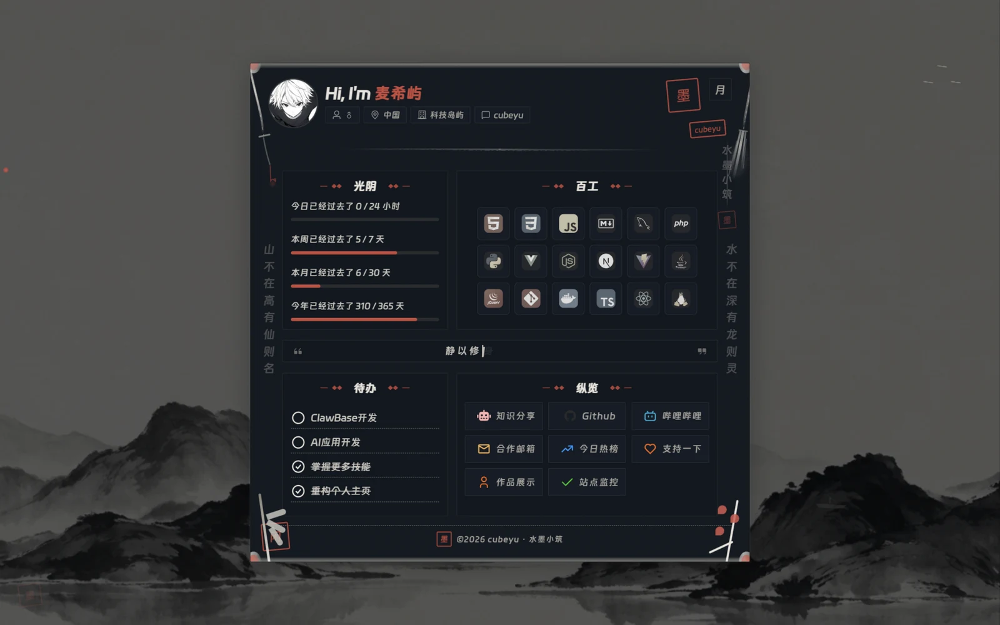
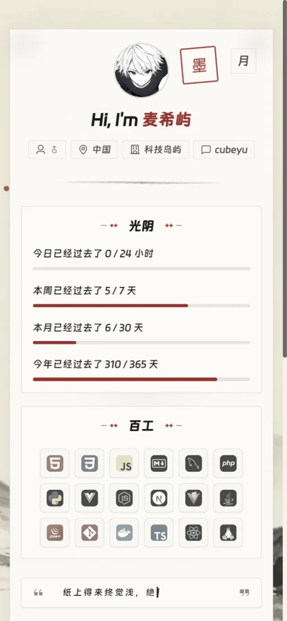

<div align="center">



[](https://vuejs.org/)
[](https://vite.dev/)
[](./LICENSE)


**[🌐 在线预览](https://techisle.top/)** · **[⚙️ 快速部署](#-快速部署三步走)** · **[📋 配置手册](#-配置手册--定制你的水墨小筑)**

</div>

---

## 🖼️ 页面预览

> 无需多言,先看真章 —— 同一页面,昼夜两种意境。

| ☀️ 日 · 宣纸 | 🌙 夜 · 碑拓 |
| :---: | :---: |
|  |  |

<div align="center">



<sub>📱 移动端自适应布局,三档断点响应式</sub>

</div>

---

## 📰 项目速览

**一句话总结**:用 `Vue 3` + `Vite` 打造的轻量个人主页。纯水墨丹青风格,五色墨韵(焦、浓、重、淡、清),朱砂印泥贯穿始终,宣纸为底,山水为屏。全 JSON 模块化配置 —— 改几行字,便是你的一方天地。

| 要素 | 详情 |
| :---: | :--- |
| **作者** | cubeyu · 麦希屿 |
| **站点** | [techisle.top](https://techisle.top/) |
| **协议** | [MIT License](./LICENSE) |
| **仓库** | [cubeyu/Simple-Homepage](https://github.com/cubeyu/Simple-Homepage) |

### ✨ 特性一览

- 🌓 **日月双主题** — 日为宣纸(米白),夜为碑拓(墨蓝),`localStorage` 持久化,启动时内联主题脚本防闪烁(FOUC)
- 🏔️ **水墨山水长卷** — 远山层叠,云雾飘渺,飞鸟翩跹,扁舟一叶;WebP 背景图 + 纯 CSS 动效
- 🖋️ **朱砂墨点光标** — PC 端朱红笔锋 + 墨色拖尾(轨迹合并优化),移动端自动隐藏
- ✍️ **笔墨打字机** — 古诗词与名言交替轮播,打字速度自然浮动,如毛笔落纸晕染
- ⏳ **时光进度条** — 今日 / 本周 / 本月 / 本年四重进度,墨色渐变填充
- 📜 **卷轴形制主卡片** — 四角写意装饰(剑、笔、竹、梅),竖排题字,朱砂闲章散落
- 🛠️ **技术栈展示** — Iconify 图标默认去饱和,悬停恢复原色,如墨色中渐现真容
- 🧩 **全 JSON 配置** — 内容与代码完全分离,零代码上手
- ⚡ **性能优化** — WOFF2 字体子集加载、WebP 背景、异步组件、关键 CSS 内联
- 📱 **响应式适配** — 桌面端 / 平板 / 手机端三档断点

---

## 🚀 快速部署三步走

```bash
# 第一步 · 拉取代码
git clone https://github.com/cubeyu/Simple-Homepage.git
cd Simple-Homepage

# 第二步 · 安装依赖
npm install        # 或 pnpm install

# 第三步 · 启动开发服务器
npm run dev        # 访问终端输出的地址(默认 http://localhost:5173)
```

<details>
<summary><strong>🏭 生产构建与代码检查</strong></summary>

```bash
npm run build      # 构建生产版本
npm run preview    # 本地预览生产构建

npm run lint       # ESLint 代码检查
npm run format     # Prettier 自动格式化
```

</details>

---

## 📋 配置手册 · 定制你的水墨小筑

> 所有配置文件位于 `src/config/`,**改 JSON 即改页面**,无需触碰 Vue 代码。

### 📌 `config.json` — 个人名片

```json
{
  "name": "麦希屿",
  "age": "18",
  "zodiac": "白羊",
  "avatarUrl": "头像链接",
  "infoTags": {
    "sex": "男",
    "company": "科技岛屿",
    "province": "中国",
    "github": "cubeyu"
  },
  "professions": ["我的世界", "AI应用开发"]
}
```

### 🔗 `linkBtn.json` — 快捷导航

最多 3 列 × 4 行(12 个按钮),图标名来自 [Iconify](https://icon-sets.iconify.design/):

```json
{
  "linkBtn": [
    {
      "icon": "mdi:github",
      "text": "Github",
      "color": "#2b2b2b",
      "url": "https://github.com/cubeyu"
    }
  ]
}
```

### 🛠️ `techStack.json` — 技术栈展示

```json
{
  "techStack": [
    { "icon": "vscode-icons:file-type-vue", "name": "Vue" },
    { "icon": "vscode-icons:file-type-python", "name": "Python" }
  ]
}
```

### 📝 `todo.json` — 个人计划

```json
{
  "todoList": [
    { "text": "学习新技能", "checked": false },
    { "text": "写一篇博客", "checked": true }
  ]
}
```

### ⌨️ `typewriter.json` — 打字机语录

古诗词、名言警句,一行为一句:

```json
[
  "山不在高,有仙则名",
  "水不在深,有龙则灵",
  "长风破浪会有时,直挂云帆济沧海"
]
```

---

## 🎨 设计语言 · 水墨丹青

### 五色墨韵

以传统中国画"墨分五色"为设计基石(下表徽章即实际色值):

| 墨色 | 徽章 | 用途 |
| :---: | :--- | :--- |
| **焦墨** |  | 标题、重点文字 |
| **浓墨** |  | 正文文字 |
| **重墨** |  | 次要文字 |
| **淡墨** |  | 辅助文字 |
| **清墨** |  | 占位、提示文字 |

### 朱砂印泥

贯穿双主题的点睛之色:亮色 `#9c2c2c`(沉稳朱砂)· 暗色 `#c94a3f`(温润印泥)。用于印章、链接、进度点、按钮点缀。

### 双主题意境

| 主题 | 底色 | 意境 |
| :---: | :--- | :--- |
| ☀️ **日 · 宣纸** | `#f7f3eb` 米白宣纸 | 日间展卷,墨香四溢 |
| 🌙 **夜 · 碑拓** | `#0a0e14` 墨蓝深靛 | 夜读碑帖,星月相伴 |

---

## 🧱 技术架构

### 技术栈

| 技术 | 版本 | 角色 |
| :---: | :---: | :--- |
|  | 3.5+ | 渐进式 UI 框架 |
|  | 7.3+ | 构建工具 |
|  | 5.0+ | 统一图标框架 |
|  | 10+ | 代码检查(Flat Config) |
|  | 3.x | 代码格式化 |
| 纯 CSS 水墨 | 原生 | 山水背景 + 全部装饰元素 |

### 项目结构

```text
Simple-Homepage/
├── docs/                        # 📷 README 配图与截图
│   ├── readme/                  # Hero 横幅(SVG)
│   └── screenshots/             # 页面截图(WebP)
├── public/                      # 静态公共资源
│   ├── icons/tech/              # 技术栈图标
│   ├── bg-inkwash.webp          # 水墨山水背景图
│   └── favicon.ico
├── src/
│   ├── assets/
│   │   ├── css/                 # App.css / MainCard.css
│   │   └── fonts/               # 钉钉进步体(WOFF2)
│   ├── components/              # Vue 组件
│   │   ├── CustomCursor.vue     # 朱砂墨点光标
│   │   ├── Header.vue           # 头部(头像 + 问候 + 标签)
│   │   ├── LinkBtn.vue          # 水墨风格链接按钮
│   │   ├── ParticlesBackground.vue  # 水墨山水背景
│   │   ├── TechStack.vue        # 技术栈展示
│   │   ├── TimeProgress.vue     # 时光进度条
│   │   ├── TodoList.vue         # 待办事项列表
│   │   └── Typewriter.vue       # 打字机效果
│   ├── composables/             # 组合式函数
│   │   ├── useInkTrail.js       # 墨迹拖尾轨迹(合并优化)
│   │   └── useTheme.js          # 主题管理(localStorage 持久化)
│   ├── config/                  # 🔧 可配置文件(零代码修改入口)
│   │   ├── config.json          # 个人信息
│   │   ├── linkBtn.json         # 链接按钮
│   │   ├── techStack.json       # 技术栈展示
│   │   ├── todo.json            # 待办事项
│   │   └── typewriter.json      # 打字机语录
│   ├── views/
│   │   └── MainCard.vue         # 主卡片页面
│   ├── App.vue                  # 根组件
│   ├── main.js                  # 入口文件
│   └── style.css                # 全局样式 + 主题变量
├── index.html                   # 入口(内联关键主题 CSS 防 FOUC)
├── eslint.config.cjs            # ESLint Flat Config
├── .prettierrc                  # Prettier 配置
├── vite.config.js
├── CHANGELOG.md                 # 变更记录
├── LICENSE
└── README.md
```

---

## 🔮 版本路线图

### ✅ 已完成

- [x] 响应式布局(桌面 / 平板 / 手机三档)
- [x] 日月双主题切换(宣纸 / 碑拓)+ 防闪烁
- [x] 五色墨韵设计系统
- [x] 水墨山水背景(远山、云雾、飞鸟、扁舟)
- [x] 朱砂墨点光标 + 墨迹拖尾
- [x] 卷轴形制主卡片 + 四角装饰
- [x] 时光进度条
- [x] 打字机效果(古诗词 + 名言)
- [x] 模块化 JSON 配置
- [x] 首屏性能优化(WOFF2 / WebP / 异步组件 / 关键 CSS 内联)
- [x] SEO meta 标签
- [x] 依赖安全漏洞清零(`npm audit` 通过)

### 🔮 规划中

- [ ] 多语言支持 (i18n)
- [ ] PWA 离线支持
- [ ] 字体子集化(进一步减小体积)
- [ ] 更多水墨装饰元素可选

---

## 🤝 贡献指南

1. Fork 本仓库
2. 创建特性分支 (`git checkout -b feature/amazing-feature`)
3. 提交更改 (`git commit -m 'feat: add amazing feature'`)
4. 推送到分支 (`git push origin feature/amazing-feature`)
5. 发起 Pull Request

---

<div align="center">

**© 2026 cubeyu · 麦希屿** · Published under the [MIT License](./LICENSE)

墨香四溢,笔走龙蛇 🖌️

**[techisle.top](https://techisle.top/)**

</div>
